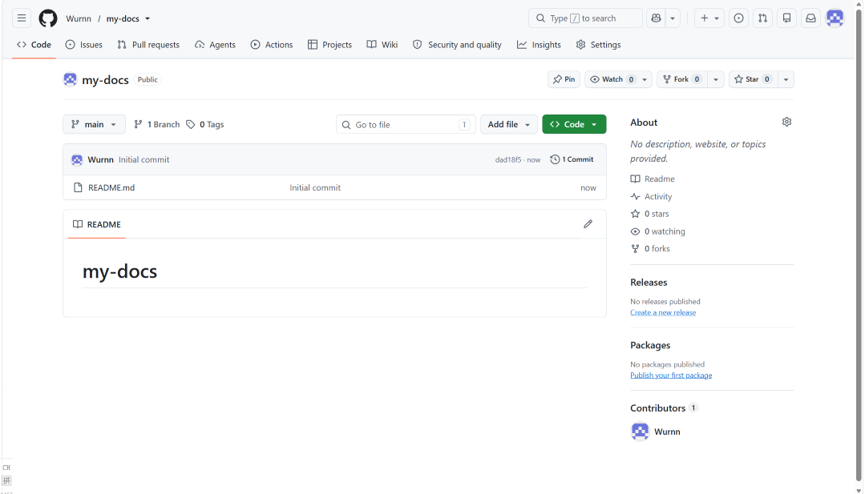
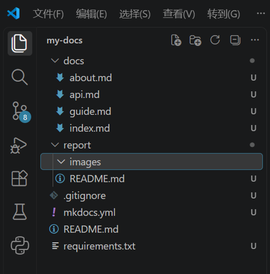
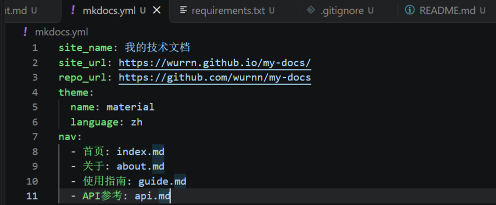
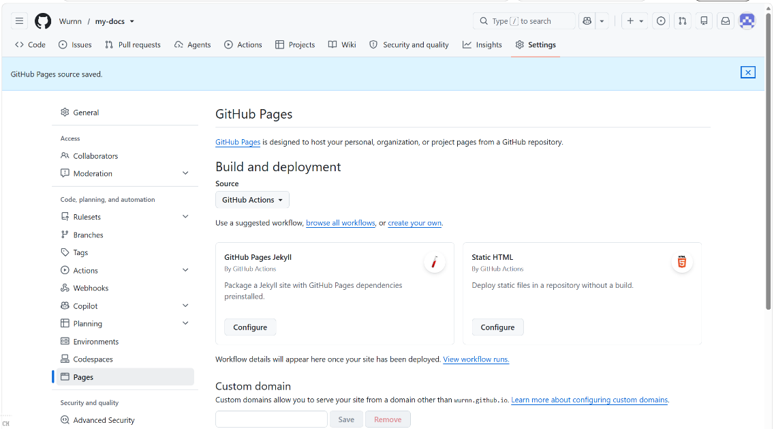
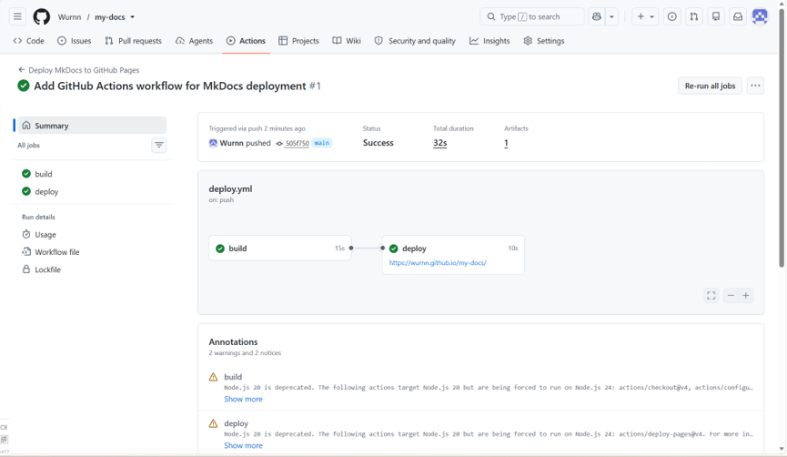
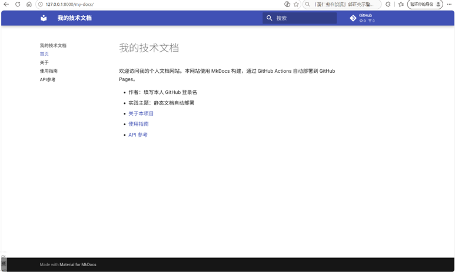
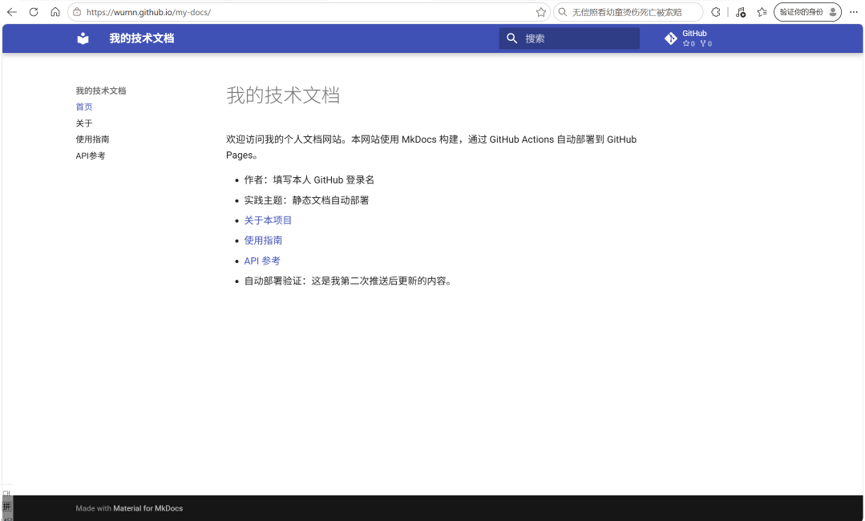

# 实践项目2：个人实验报告

## 1. 基本信息
- GitHub 登录名：Wurnn
- 个人仓库地址：https://github.com/Wurnn/my-docs
- 最终网站地址：https://Wurrn.github.io/my-docs/

## 2. 实践过程与关键截图

### 2.1 仓库创建
说明：创建了 Public 公开仓库，并克隆到本地。

### 2.2 项目结构与 MkDocs 配置
说明：完成了文档目录及相关配置文件的编写。

### 2.3 本地构建或预览
说明：在本地终端执行了构建与预览命令，确认网页排版及导航无误。

### 2.4 Pages 设置
说明：在仓库设置中将 Pages 发布来源配置为 GitHub Actions。

### 2.5 Actions 首次构建和部署
说明：首次推送代码后，触发了工作流，build 和 deploy 均成功。

### 2.6 网站访问与四页导航检查
说明：访问了部署成功的网址，检查了四个页面的导航、表格和代码块均正常。

### 2.7 第二次推送与自动更新验证
说明：修改了 index.md 并在网页端提交，Actions 自动触发并成功部署，网站内容同步更新。
- 对应提交链接：（去你的仓库首页，点进那次修改，复制网址贴这里）
- 对应 Actions 运行链接：（去 Actions 页面，点进第二次成功的记录，复制网址贴这里）

## 3. 问题与解决
**问题**：在本地终端推送代码时遇到了认证失败（403）以及 SSL 错误。
**解决**：清理了本地的 Git 凭证，并采用网页端直接上传文件的方式绕过网络限制，最终成功完成部署。

## 4. 原理理解
1. `docs/` 保存的是 Markdown 源文件；`site/` 保存的是 MkDocs 构建生成的 HTML 静态网页产物。不能手工修改 `site/`，因为每次重新构建或部署时，它都会被新生成的产物自动覆盖。
2. 本次工作流在向 `main` 分支 push，且修改了 `docs/`、`mkdocs.yml`、`requirements.txt` 或 `deploy.yml` 时自动运行。
3. `build` 任务负责拉取代码、安装依赖并把文档编译成网页包；`deploy` 任务负责把编译好的网页包发布到 GitHub Pages 服务器上。
4. 只修改 `report/README.md` **不会**触发部署，因为 `deploy.yml` 中的 `paths` 限制只监控文档相关的文件。
5. 因为使用了官方的 Pages Actions（包含 `upload-pages-artifact` 和 `deploy-pages`），可以直接将构建产物部署到 Pages，无需再像旧方案那样手动推送到 `gh-pages` 分支。
